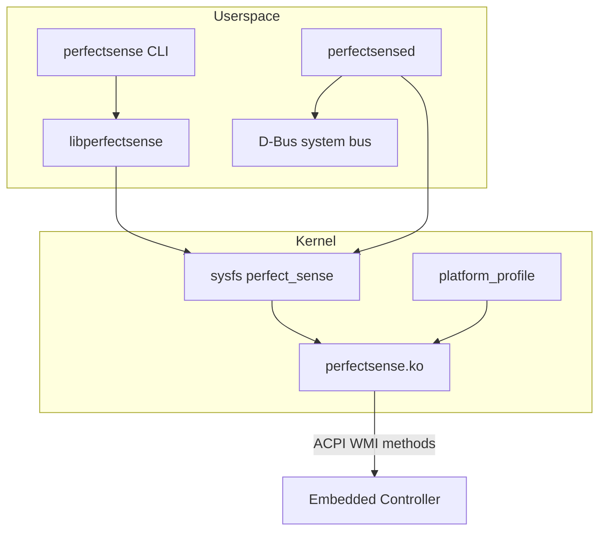

# Architecture overview

## Design principles

1. **Kernel owns firmware.** All Acer gaming WMI calls live in `perfectsense.ko`.
   Userspace never invokes WMI directly.
2. **Sysfs is the ABI.** Stable attribute names and formats; `api_version` bumps
   when breaking changes are intentional.
3. **Idle by default.** No temperature polling unless FanAggressor (offset mode)
   is explicitly enabled.
4. **Events over busy-wait.** Firmware/key events surface as kernel uevent/input;
   `perfectsensed` translates them to D-Bus signals for desktop consumers.
5. **Root daemon, least surprise.** `perfectsensed` runs as a **system** service
   so sysfs writes and future privileged ops do not fight session permissions.
6. **PHN16-72-74VX first.** Probe is DMI-gated; structure allows later quirks
   without scattering `#ifdef` soup.

## WMI path

On this notebook, Predator Sense–class features are exposed through ACPI **WMI**
method calls (vendor GUID + numeric method IDs for fans, misc/thermal profile,
RGB, battery health, and related controls). The embedded controller (EC) is the
ultimate actuator; WMI is the mediated door the OEM firmware provides.

## Naming decisions

| Item | Choice | Rationale |
|------|--------|-----------|
| Kernel module | `perfectsense` | Product name; distinct from in-tree `acer-wmi` |
| Sysfs group | `perfect_sense` | Clean break; documented ABI; no fake OEM path compatibility |
| Platform profile | standard `/sys/firmware/acpi/platform_profile` | Desktop-wide convention (`power-profiles-daemon`, etc.) |
| CLI | `perfectsense` | Same as product |
| Daemon | `perfectsensed` | Conventional `*d` suffix for system services |
| Shared library | `libperfectsense` | Stable C API for future UIs without shelling out |
| D-Bus name | `org.perfectsense.Sense1` | Product-centric reverse-DNS; `1` = major API generation |

We intentionally **do not** reuse `predator_sense` as the primary sysfs name:
this project is a clean replacement stack, not a drop-in path clone for older
tools. Consumers should bind to PerfectSense docs/`api_version`.

## Module exclusivity

Only one driver should own the Acer gaming WMI GUID on a machine. PerfectSense
expects:

- `blacklist acer-wmi` (and any conflicting out-of-tree gaming WMI module)
- documented install steps so users do not load two writers to the same EC path

Coexistence is fragile (duplicate platform devices, racing method calls) and is
**not** supported.

## Event model

1. **Kernel:** turbo / mode-key style notifications become uevents and/or input
   events (no D-Bus in kernel space).
2. **`perfectsensed`:** subscribes, debounces if needed, emits D-Bus signals
   such as profile changes or turbo-key presses.
3. **One-shot CLI:** reads/writes sysfs via `libperfectsense` without requiring
   the daemon for simple get/set.

## FanAggressor (offset mode)

When disabled (default): firmware/EC auto curve only; daemon does not run a
thermal timer.

When enabled: `perfectsensed` uses `timerfd`/`epoll` to apply an additive offset
on top of captured native duty — engage/disengage thresholds with hysteresis.
Disabling offset cancels the timer and returns fans to auto.

## CPU power controls

Governor, EPP, turbo, RAPL PL1/PL2, and max frequency are **userspace**
concerns (sysfs `cpufreq` / `powercap`), coordinated by the library/daemon.
They are separate from WMI thermal profile but can be composed into named
power presets later.

## Documentation split

| Tree | Meaning |
|------|---------|
| `docs/*/roadmap/` | Plan and phases — may describe work **not yet done** |
| `docs/*/implementation/` | Only behavior that **exists in the tree today** |
| `docs/*/reverse-engineering/` | Firmware methodology and findings |
| `docs/*/architecture/` | Enduring design (this document) |

## Packaging

- Userspace: **Meson**
- Kernel: **DKMS**
- Distro focus: **Arch Linux** (`packaging/arch/` PKGBUILD)
