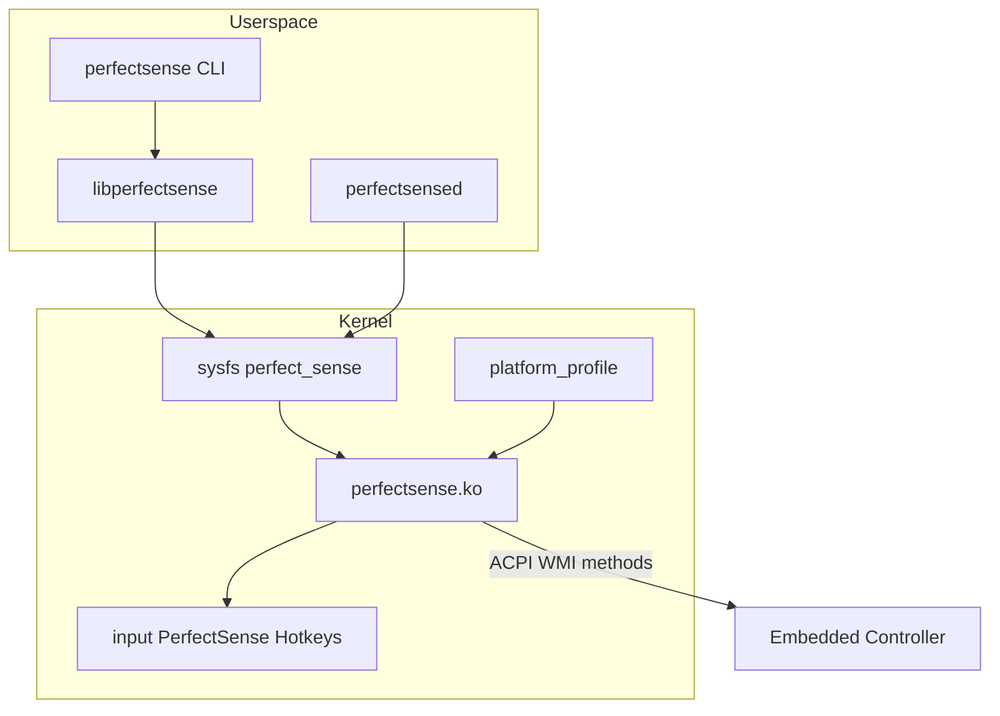

# Architecture overview

## Design principles

1. **Kernel owns firmware.** All Acer gaming WMI calls live in `perfectsense.ko`.
   Userspace never invokes WMI directly.
2. **Sysfs is the ABI.** Stable attribute names and formats; `api_version` bumps
   when breaking changes are intentional. **Interfaces and automation talk to
   sysfs (or `libperfectsense`) — the closest path to the hardware.** There is
   no D-Bus control plane and the CLI is not an IPC layer.
3. **Idle by default.** No temperature polling unless FanAggressor (offset mode)
   is explicitly enabled.
4. **Events over busy-wait.** Firmware/key events surface as kernel uevent/input;
   `perfectsensed` applies policy (mode cycle, AC demote, turbo) and logs; UIs
   that need live events watch udev or the `PerfectSense Hotkeys` input device.
5. **CLI is for humans.** `/usr/bin/perfectsense` is a convenience flashlight
   (manual status / one-shots). UIs must **not** shell out to it; link
   `libperfectsense` or write sysfs (usually as root / capable group).
6. **Root daemon for policy only.** `perfectsensed` runs as a **system** service
   for hotkeys/AC/FanAggressor—not as an RPC bus.
7. **PHN16-72-74VX first.** Probe is DMI-gated; structure allows later quirks
   without scattering `#ifdef` soup.

## WMI path

On this notebook, Predator Sense–class features are exposed through ACPI **WMI**
method calls (vendor GUID + numeric method IDs for fans, misc/thermal profile,
RGB, battery health, and related controls). The embedded controller (EC) is the
ultimate actuator; WMI is the mediated door the OEM firmware provides.

## Naming decisions

| Item | Choice | Rationale |
|------|--------|-----------|
| Kernel module | `perfectsense` | Product name; distinct from in-tree `acer-wmi` |
| Sysfs group | `perfect_sense` | Clean break; documented ABI; no fake OEM path compatibility |
| Platform profile | standard `/sys/firmware/acpi/platform_profile` | Desktop-wide convention (`power-profiles-daemon`, etc.) |
| Shared library | `libperfectsense` | C API for UIs — same ABI as sysfs, no process hop |
| CLI | `perfectsense` | Human manual tool only |
| Daemon | `perfectsensed` | Hotkeys / AC / FanAggressor policy (not RPC) |

We intentionally **do not** reuse `predator_sense` as the primary sysfs name:
this project is a clean replacement stack, not a drop-in path clone for older
tools. Consumers should bind to PerfectSense docs/`api_version`.

## Module exclusivity

Only one driver should own the Acer gaming WMI GUID on a machine. PerfectSense
expects:

- `blacklist acer-wmi` (and any conflicting out-of-tree gaming WMI module)
- documented install steps so users do not load two writers to the same EC path

Coexistence is fragile (duplicate platform devices, racing method calls) and is
**not** supported.

## Event model

1. **Kernel:** turbo / mode-key / AC notifications become uevents and input
   events.
2. **`perfectsensed`:** subscribes via sd-device, debounces, applies policy
   (profile cycle, turbo latch, AC demote/restore).
3. **One-shot CLI (humans):** optional flashlight over the same sysfs ABI.
   FanAggressor `set`/`on`/`off` save config and send **SIGHUP** so the daemon
   reloads the timer. Desktop UIs should use lib/sysfs, not `system("perfectsense …")`.

## FanAggressor (offset mode)

When disabled (default): firmware/EC auto curve only; daemon does not run a
thermal timer.

When enabled: `perfectsensed` uses `timerfd` to apply an additive offset on top
of captured native duty — engage/disengage thresholds with hysteresis.
Disabling offset cancels the timer and returns fans to auto.

## CPU power controls

Governor, EPP, turbo, RAPL PL1/PL2, and max frequency are **userspace**
concerns (sysfs `cpufreq` / `powercap`). `ps_mode_set()` / `perfectsense mode set`
best-effort apply matching governor/EPP for the thermal profile (from
balanced-performance upward the governor is `performance`) and keep a
CPU snapshot for turbo restore. Named `cpu preset` values remain available
for explicit composition and `--sync-profile`.

## Packaging

- Distro focus: **Arch Linux** (`packaging/arch/` PKGBUILD)
- DKMS for `perfectsense.ko`
- `perfectsensed.service` + `.path` enabled on install
