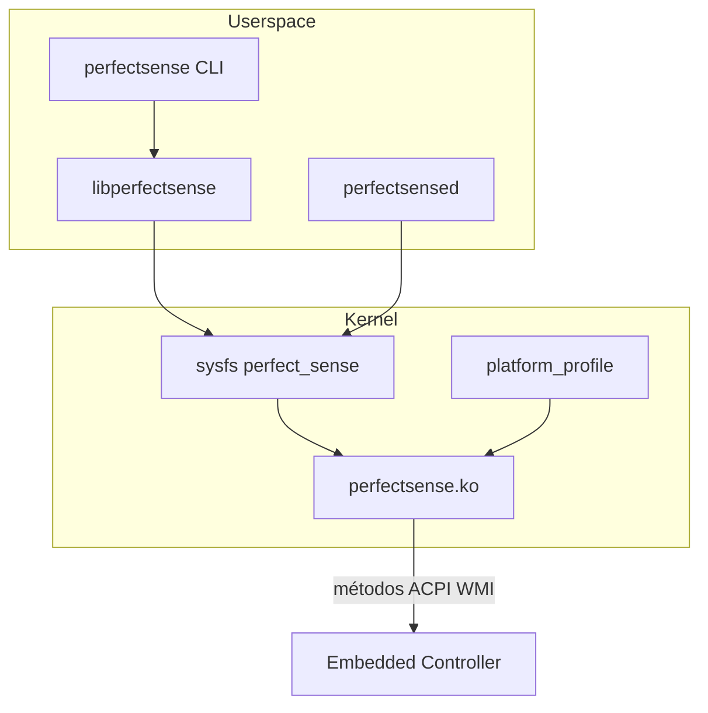

# Visão geral da arquitetura

## Princípios de design

1. **O kernel é dono do firmware.** Todas as chamadas WMI Acer gaming ficam em
   `perfectsense.ko`. O userspace nunca invoca WMI diretamente.
2. **Sysfs é a ABI.** Nomes e formatos estáveis; `api_version` sobe quando houver
   mudança intencional incompatível. Apps/scripts usam sysfs/CLI — **sem D-Bus**.
3. **Idle por omissão.** Sem poll de temperatura salvo quando o FanAggressor
   (modo offset) estiver explicitamente ativo.
4. **Eventos em vez de busy-wait.** Teclas/firmware → uevent/input; o daemon
   aplica política (ciclo de modo, demote AC, turbo). UIs escutam udev/input.
5. **Daemon root só para política.** Hotkeys/AC/FanAggressor — não é um bus RPC.
   Get/set privilegiado: sysfs + `/usr/bin/perfectsense` (root).
6. **PHN16-72-74VX primeiro.** Probe com gate DMI; estrutura pronta para quirks
   futuros sem espalhar condicionais.

## Caminho WMI

Neste notebook, as funções à la Predator Sense passam por **WMI** ACPI (GUID do
fornecedor + IDs numéricos de método: fans, perfil térmico/misc, RGB, bateria,
etc.). O EC é o atuador final; WMI é a porta mediada pelo firmware.

## Decisões de nomes

| Item | Escolha | Motivo |
|------|---------|--------|
| Módulo | `perfectsense` | Nome do produto; distinto de `acer-wmi` |
| Sysfs | `perfect_sense` | Corte limpo; ABI documentada |
| CLI | `perfectsense` | Mesmo produto |
| Daemon | `perfectsensed` | Sufixo `*d` convencional |
| Lib | `libperfectsense` | API C para UIs sem shell out |

## Modelo de eventos

1. **Kernel:** turbo / modo / AC → uevent + input.
2. **`perfectsensed`:** assina (sd-device), debounce, aplica política; **SIGHUP**
   recarrega FanAggressor.
3. **CLI:** get/set sysfs sem precisar do daemon (exceto timer FA).

## Empacotamento

Alvo: **Arch Linux** (`packaging/arch/`). DKMS + `perfectsensed.service`/`.path`.
