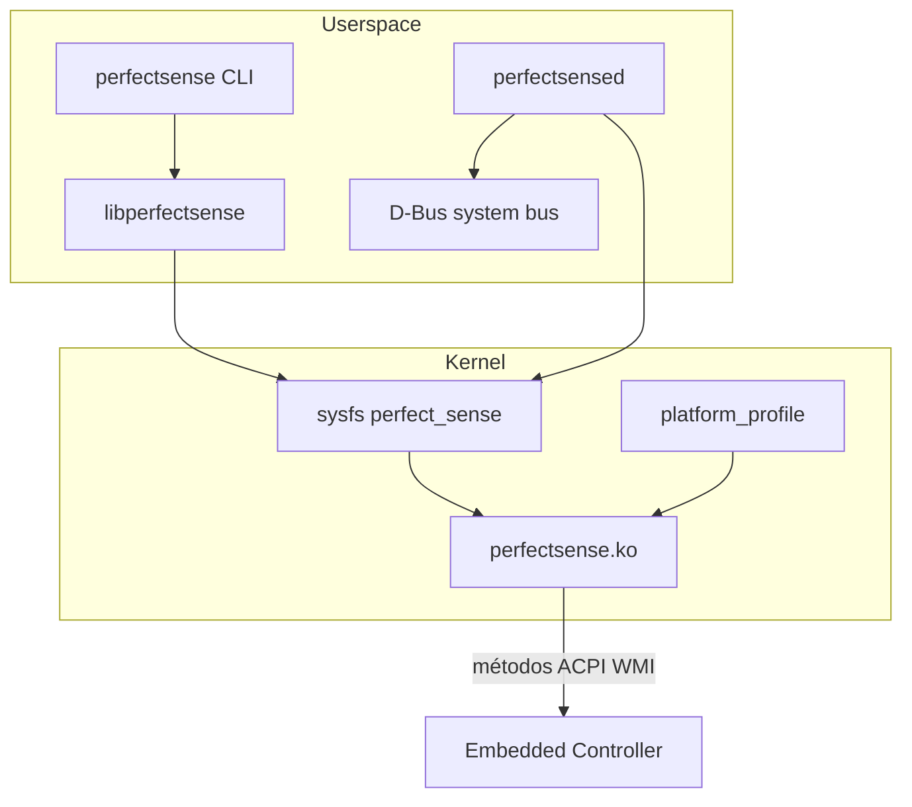

# Visão geral da arquitetura

## Princípios de design

1. **O kernel é dono do firmware.** Todas as chamadas WMI Acer gaming ficam em
   `perfectsense.ko`. O userspace nunca invoca WMI diretamente.
2. **Sysfs é a ABI.** Nomes e formatos estáveis; `api_version` sobe quando houver
   mudança intencional incompatível.
3. **Idle por omissão.** Sem poll de temperatura salvo quando o FanAggressor
   (modo offset) estiver explicitamente ativo.
4. **Eventos em vez de busy-wait.** Teclas/firmware → uevent/input no kernel;
   `perfectsensed` traduz para sinais D-Bus.
5. **Daemon root, poucas surpresas.** `perfectsensed` é serviço **system** para
   escritas sysfs e futuras ops privilegiadas não brigarem com permissões de
   sessão.
6. **PHN16-72-74VX primeiro.** Probe com gate DMI; estrutura pronta para quirks
   futuros sem espalhar condicionais.

## Caminho WMI

Neste notebook, as funções à la Predator Sense passam por **WMI** ACPI (GUID do
fornecedor + IDs numéricos de método: fans, perfil térmico/misc, RGB, bateria,
etc.). O EC é o atuador final; WMI é a porta mediada pelo firmware.

## Decisões de nomes

| Item | Escolha | Porquê |
|------|---------|--------|
| Módulo | `perfectsense` | Nome do produto; distinto do `acer-wmi` in-tree |
| Grupo sysfs | `perfect_sense` | Corte limpo; ABI documentada; sem fingir compat de paths antigos |
| Platform profile | `/sys/firmware/acpi/platform_profile` | Convenção desktop |
| CLI | `perfectsense` | Mesmo nome do produto |
| Daemon | `perfectsensed` | Sufixo `*d` convencional |
| Biblioteca | `libperfectsense` | API C estável para UIs futuras |
| D-Bus | `org.perfectsense.Sense1` | DNS reverso centrado no produto; `1` = geração da API |

**Não** usamos `predator_sense` como nome sysfs principal: este stack é
substituto limpo, não um clone de paths para ferramentas antigas.

## Exclusividade do módulo

Só um driver deve dono do GUID WMI gaming Acer. PerfectSense espera:

- `blacklist acer-wmi` (e módulos out-of-tree conflituosos)
- install documentado para evitar dois writers no mesmo caminho EC

Coexistência **não** é suportada.

## Modelo de eventos

1. **Kernel:** notificações de tecla turbo/modo → uevent e/ou input.
2. **`perfectsensed`:** assina, debounced se preciso, emite sinais D-Bus.
3. **CLI one-shot:** lê/escreve sysfs via lib **sem** exigir o daemon.

## FanAggressor (modo offset)

Desligado (padrão): só curva auto do firmware; sem timer térmico.

Ligado: `timerfd`/`epoll` aplica offset aditivo com histerese. Desligar cancela
o timer e devolve fans a auto.

## Controles de CPU

Governor, EPP, turbo, RAPL e frequência máx. são **userspace** (`cpufreq` /
`powercap`), coordenados por lib/daemon — compostos depois em presets se útil.

## Separação da documentação

| Árvore | Significado |
|--------|-------------|
| `docs/*/roadmap/` | Plano / fases — pode descrever o que **ainda não** existe |
| `docs/*/implementation/` | Só o que **existe** no código hoje |
| `docs/*/reverse-engineering/` | Metodologia e achados de firmware |
| `docs/*/architecture/` | Design duradouro |

## Packaging

- Userspace: **Meson**
- Kernel: **DKMS**
- Distro: **Arch Linux** (`packaging/arch/`)
